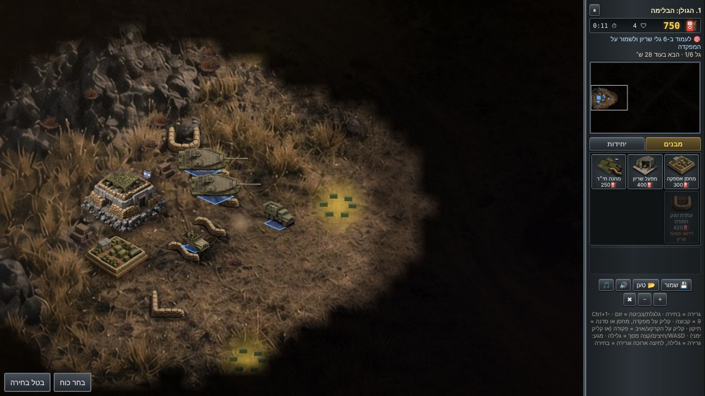

# מבצע מדבר · 1973

▶ לשחק עכשיו בדפדפן: https://yontanbe.github.io/israel-rts-1973/

להורדה למחשב: [Releases](https://github.com/yontanbe/israel-rts-1973/releases/latest)

איך בנינו את זה עם AI, בלי לכתוב קוד: [המאמר המלא על מבצע מדבר 1973 וקו האש](https://theailazyleader.com/he/blog/israeli-browser-games-ai-kav-haesh-1973-hebrew)

משחק אחות: [קו האש](https://github.com/yontanbe/kav-haesh), משחק יריות תלת מימד על מלחמת ששת הימים. [לשחק](https://yontanbe.github.io/kav-haesh/)

⭐ נהניתם? תנו כוכב לריפו (כפתור Star למעלה). זה עוזר לעוד אנשים למצוא את המשחק.

משחק אסטרטגיה בזמן אמת בדפדפן על מלחמת יום הכיפורים. בונים בסיס, אוספים דלק במשאיות, מגייסים שריון וחי״ר, ומחזיקים את הקו מרמת הגולן ועד מעבר לתעלה. המשחק עובד במחשב ובטלפון, אפשר להתקין אותו כאפליקציה, והוא רץ גם בלי אינטרנט.



## מה יש במשחק
- 10 שלבים עם תדריך, מפה, תאריך ומקום, ודיווח בסוף כל שלב. שלבים 3 ו-8 מתרחשים בלילה.
- 10 מבנים: מפקדה, מחסן אספקה, מפעל שריון, מחנה חי״ר, עמדת טנק חפורה, מכ״ם, סדנת שדה, סוללת הוק, עמדת ארטילריה ומנחת. לכל מבנה יש תנאי קדם, ומבנים חדשים נפתחים לאורך המערכה.
- כוחות צה״ל: משאית אספקה, ג׳יפ נ״ט, שוט, טירן, מגח, נגמ״ש M113, תומ״ת M109, חוליית נ״ט וצנחנים.
- כוחות האויב: T-55, T-62, BTR, חוליות סאגר, עמדות מבוצרות, סוללות SAM ומיג-21.
- תקיפות אוויר של פאנטום ומיראז׳. מנחת מקצר את ההמתנה ומוזיל את התקיפה, וסוללת הוק מיירטת מיגים.
- כלים מנוסים עולים בדרגה. כל שלב מדורג בשלושה כוכבים, ויש ארבע רמות קושי.
- סוגי משימות שונים: להחזיק מול גלים, להשמיד בסיסים, להגן על מעוזי קו בר-לב (שלב 4), לכבוש שלוש גבעות (שלב 7) ולשמור על אתר הגשר בצליחה (שלב 9). האויב תוקף מכמה כיוונים, צד משאיות אספקה ונסוג כשהוא פגוע.
- תגבורות שמגיעות בטור מהמערב, מסך עשן, נקודת כינוס למפעלים, ולחיצה כפולה לבחירת כל הכלים מאותו סוג.
- שדה קרב חי: שרידים בוערים נשארים על המפה, עקבות זחלים, רעידת מסך, צללי עננים, סופות אבק בסיני, הבזקי ארטילריה באופק ותאורה שונה לכל שלב (בוקר, צהריים, בין ערביים, לילה).
- חמש דמויות בדיוניות עם דיוקנאות, הודעות קשר בזמן המשחק, ואיור לכל שלב בתדריך.
- פקודות: תקיפה בתנועה (F), עצירה (X), התבצרות (G: פחות נזק וטווח ארוך יותר, בלי תזוזה), החזקת עמדה (H), ופקודה בקליק ימני על המפה הקטנה.
- ארטילריה של האויב משלב 5: אזור הפגיעה מסומן באדום שלוש וחצי שניות לפני הנחיתה, ויש זמן לפנות אותו.
- ארגזי אספקה מוצנחים לשדה: דלק, תיקון, צוות ותיק או צילומי אוויר. משימת משנה בכל שלב (למשל לא לאבד משאית, לאסוף ארגזים, להשמיד את ה-SAM) עם בונוס דלק ומדליה.
- אנימציית ריצה של 8 פריימים לחיילים, צריח שעף כשטנק מושמד, מבנים בוערים כשהם פגועים, וזיקוקי תאורה בלילה.
- איכות גרפיקה אוטומטית: אם המכשיר לא מחזיק בערך 34 פריימים בשנייה, המשחק מוריד אפקטים בעצמו.
- הדרכה מודרכת בשלב 1 (פעם אחת לכל פרופיל, אפשר לדלג).
- חשבונות מפקד, שמירה אוטומטית כל 20 שניות וכשיוצאים מהאפליקציה, וכפתור המשך שחוזר בדיוק לאותה נקודה.

## איך משחקים בלי להתקין כלום
פותחים את https://yontanbe.github.io/israel-rts-1973/ בדפדפן ולוחצים על ״שחק עכשיו״.

## התקנה

| איפה | איך |
|---|---|
| אנדרואיד, כרום | לוחצים על ״התקן״ בדף הבית, או בתפריט של כרום על ״הוספה למסך הבית״ |
| אייפון ואייפד | פותחים בספארי, לוחצים על כפתור השיתוף ואז ״הוספה למסך הבית״ |
| מחשב, כרום או אדג׳ | לוחצים על סמל ההתקנה בשורת הכתובת. המשחק נפתח כאפליקציה בחלון משלה |
| הורדה למחשב | מורידים את `mivtza-midbar-1973.zip` מעמוד ה-Releases, פותחים, ומריצים `start.bat` בווינדוס, `start.command` במק או `start.sh` בלינוקס |
| מהקוד | `git clone`, ואז `npm start` (או `./start.sh`) ופותחים את http://localhost:8080 |

ההרצה המקומית צריכה Node.js 18 ומעלה או Python 3. אין תלויות להתקנה.

### פרסום ב-GitHub Pages
1. ב-GitHub נכנסים ל-Settings, אחר כך Pages, ובוחרים Source: GitHub Actions.
2. כל push ל-main מריץ את הבדיקות ומפרסם את המשחק בכתובת `https://<user>.github.io/israel-rts-1973/`.

ב-GitHub, Pages על ריפו פרטי דורש תוכנית בתשלום. אפשרות אחרת היא Netlify, Vercel או Cloudflare Pages: מחברים את הריפו בלי פקודת build ובלי תיקיית פלט מיוחדת.

### קובץ zip להורדה
דוחפים תגית, למשל `git tag v3.0.0 && git push --tags`, וה-workflow מצרף את ה-zip ל-Release. מקומית אפשר להריץ `npm run package`, והקובץ נוצר ב-`dist/`.

## חשבונות ושמירת התקדמות
- מקומי (ברירת מחדל): ההרשמה עם שם מפקד וסיסמה נשמרת בדפדפן. לכל מפקד יש התקדמות, שמירות וכוכבים משלו. מה שאורח השיג לפני ההרשמה עובר לחשבון החדש. כדי להעביר התקדמות למכשיר אחר, מעתיקים את קוד ההעברה מחלון הפרופיל ומדביקים אותו במכשיר השני.
- ענן (רשות): יוצרים פרויקט חינמי ב-Supabase, מריצים את `supabase/schema.sql`, ומעתיקים את כתובת הפרויקט ואת ה-anon key לקובץ `config.js`. מעכשיו ההרשמה היא עם אימייל, וההתקדמות מסונכרנת לכל מכשיר. ה-anon key ציבורי מטבעו, ו-Row Level Security מאפשר לכל שחקן לקרוא ולכתוב רק את השורה שלו.

## בדיקות
```
npm test        # מנוע המשחק, מבנים, יחידות, דרגות, שמירה וטעינה, חשבונות וסנכרון ענן מדומה
npm run e2e     # בדיקת דפדפן מלאה (צריך Playwright): הרשמה, כל 10 השלבים, שמירה, המשך, אופליין, טלפון
npm run sim     # איזון: בוט משחק כל שלב 20 פעמים בכל רמת קושי
```

## מבנה הקוד
| קובץ | תפקיד |
|---|---|
| `engine.js` | מנוע: כלכלה, מבנים, יחידות, מציאת מסלול, ערפל קרב, נשק של מבנים, רסס, דרגות, כוכבים, שמירה, ובוט לסימולציות |
| `scenarios.js` | תוכן: מבנים, יחידות, 10 השלבים, תדריכים, תאריכים, מה נפתח בכל שלב ומה יש בפתיחה |
| `ui.js` | ציור, ממשק, קלט מעכבר ומגע, סאונד, קריינות ומסכי עלילה |
| `home.js` | דף הבית, חלונות ההרשמה והפרופיל |
| `account.js` | פרופילים, שמירה לכל מפקד, קוד העברה וסנכרון ענן |
| `tools/importart.py` | ממיר את האמנות שנוצרה (מבנים, חיילים, הריסות, אפקטים, דיוקנאות ואיורים) לקבצים שהמשחק משתמש בהם. המקורות בענף `art-src` |
| `tools/gen-sw.js` | בונה את רשימת הקבצים לשימוש בלי אינטרנט (`sw.js`) |

## כללי טון
כל הדמויות והיחידות בדיוניות. הקרבות הם רק בין כלים ומבנים צבאיים, בלי אזרחים ובלי דם. המערכה מסתיימת בהקדשה לזכר חללי המלחמה.

## רישיון
הקוד ברישיון MIT, ראו `LICENSE`. מותר להשתמש, לשנות ולהפיץ, גם לשימוש מסחרי, כל עוד שומרים את הודעת הרישיון. כל הדמויות והיחידות בדיוניות.
